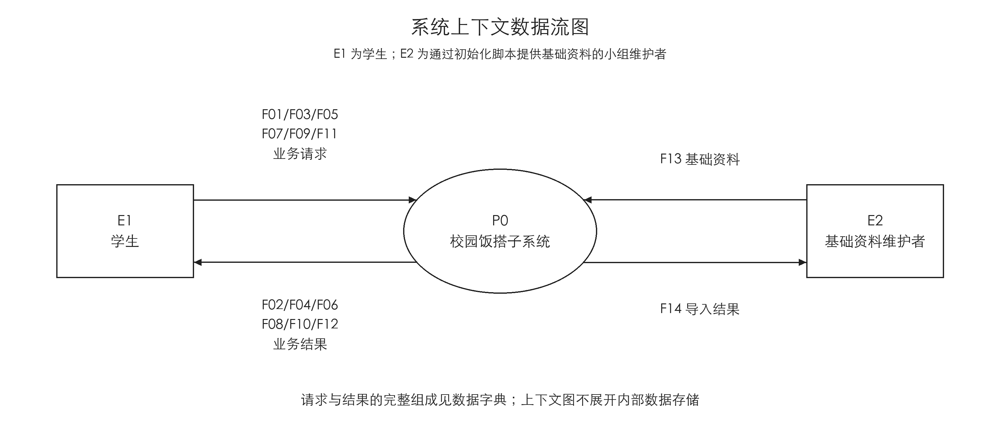
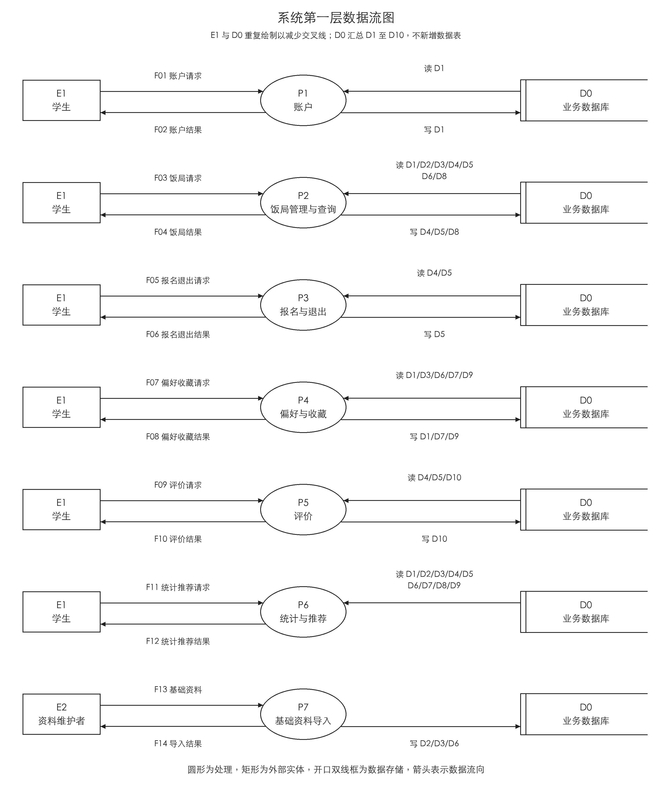
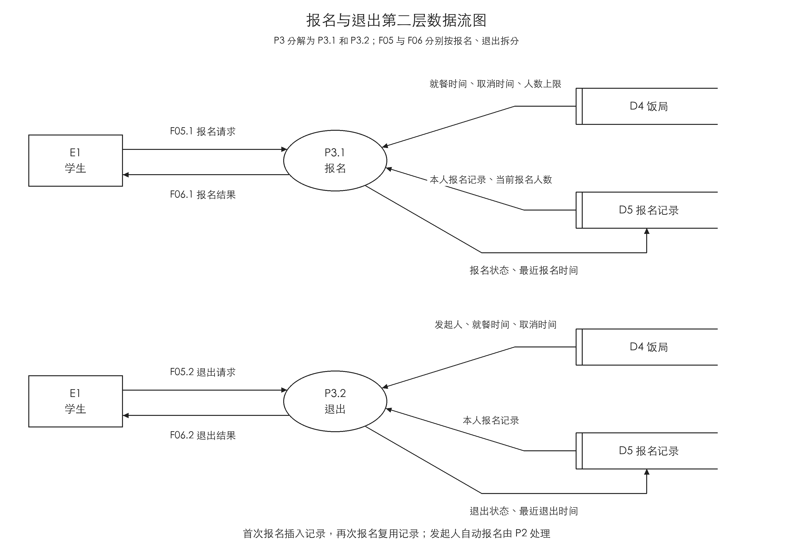
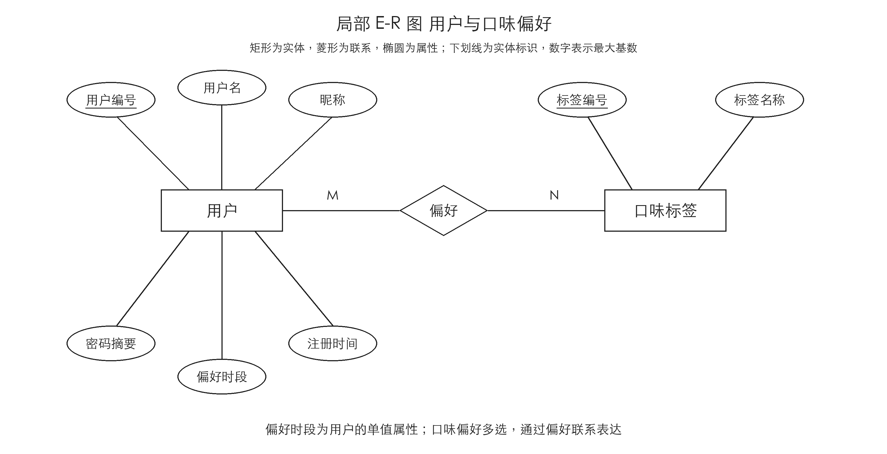
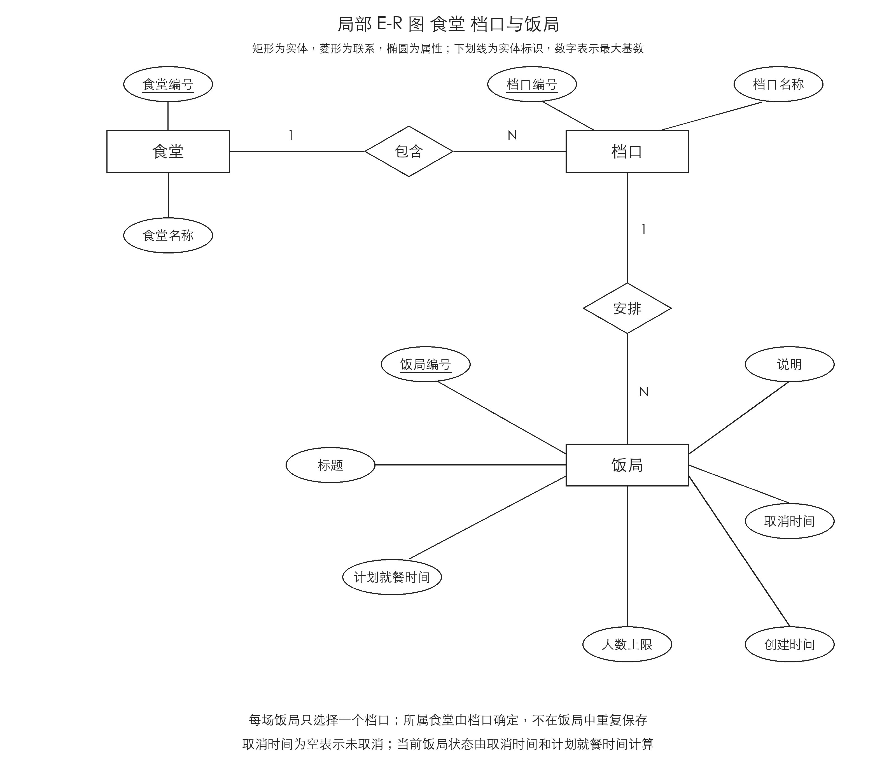
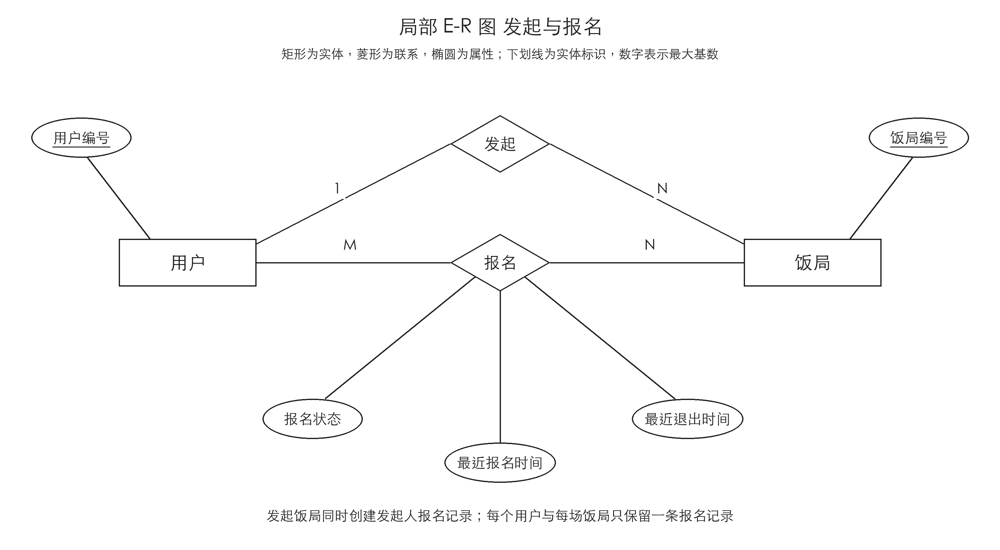
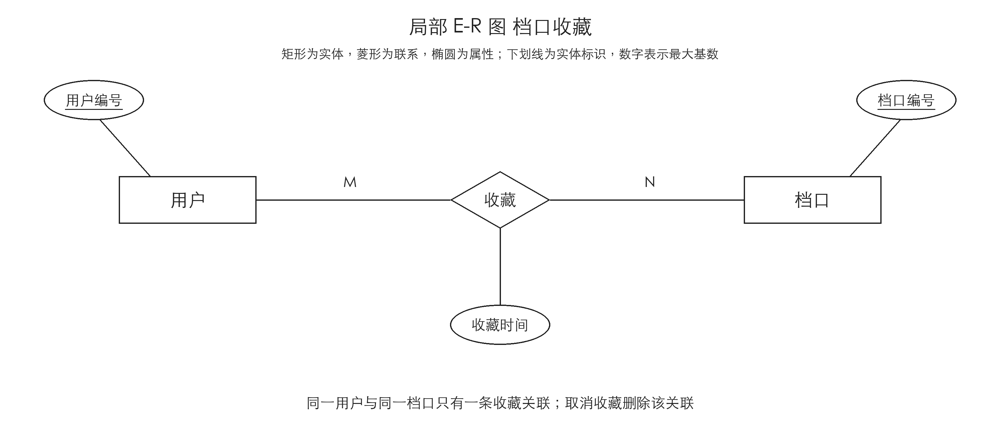
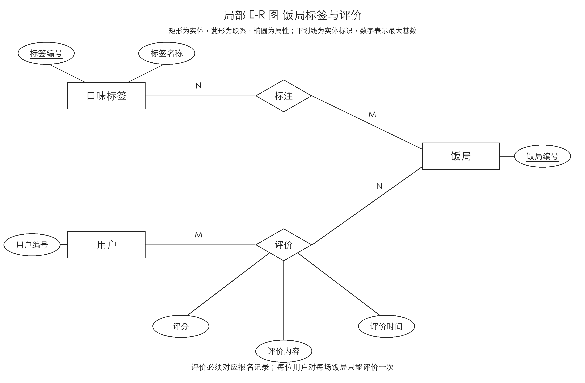
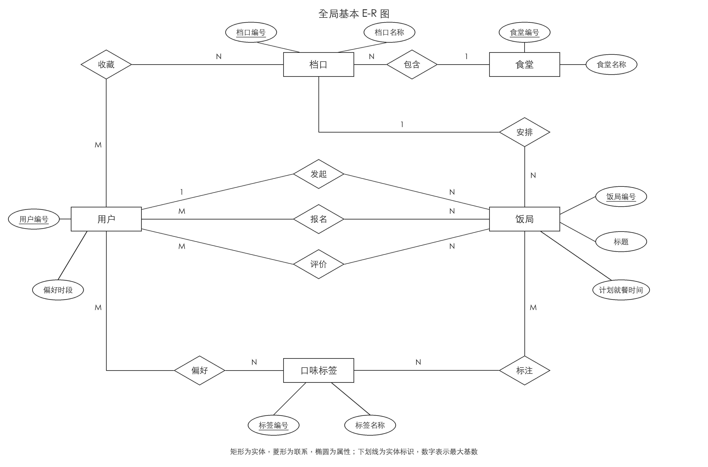

# 校园饭搭子组局与推荐系统数据库设计

本文记录 step2 至 step7 的功能需求、数据字典、概念模型、关系模式、字段规格、数据库约束与物理设计，以及 step8 至 step10 的脚本和独立实例验证。本机导入状态见第 22 节。

## 1 项目范围与环境

- 系统面向在校学生，提供账户、饭局、报名、偏好、收藏、评价、个人统计、饭局推荐和饭点热力图功能。
- 本地环境为 MySQL 8.0.46，DataGrip 连接地址为 `localhost:3306`。
- 所有业务时间按北京时间 `Asia/Shanghai`（UTC+08:00）解释，精确到秒。文中的当前时间以数据库时间为准。
- 本文依据[选题报告](./10组-数据库大作业-选题.docx)，将选题中尚未展开的规则具体化。

## 2 用户与基础资料

- 注册填写用户名、昵称和密码。用户名去除首尾普通空格后保存，区分大小写与重音，且用户间唯一；昵称允许重复。登录使用相同的用户名处理规则，退出登录结束当前登录状态。
- 注册、登录之外的业务操作均要求用户已登录。发起人和参与者是用户在某场饭局中的身份，同一用户可以发起多场饭局，也可以报名其他饭局。
- 食堂和档口由初始化脚本提供。每个档口只属于一个食堂，每场饭局只选择一个档口，所属食堂由档口确定。
- 口味标签固定为清淡、香辣、麻辣、甜口、咸鲜、素食。用户和饭局均可选择多个标签，也可不选；同一个标签不能重复选择。

## 3 用餐时段与饭局状态

用餐时段由计划就餐时间的北京时间时刻确定，每天划分为四段：

- 早餐：`06:00:00 ≤ 时刻 < 10:00:00`。
- 午餐：`10:00:00 ≤ 时刻 < 15:00:00`。
- 晚餐：`15:00:00 ≤ 时刻 < 21:00:00`。
- 夜宵：`21:00:00 ≤ 时刻 < 24:00:00`，或 `00:00:00 ≤ 时刻 < 06:00:00`。

饭局业务状态只有三种：

- 未开始：未取消，且当前时间早于计划就餐时间。
- 已开始：未取消，且当前时间已经到达或超过计划就餐时间。
- 已取消：发起人执行取消操作后进入的最终状态，不能恢复。

未取消饭局的状态随当前时间判定，无需用户确认开始。系统只记录计划就餐时间，不记录实际开始和结束时间。满员由当前报名人数判定，不作为独立饭局状态。

## 4 饭局发布 查询与修改

- 发布饭局填写标题、档口、计划就餐时间、人数上限、说明和口味标签。标题必填，说明允许为空，口味标签允许不选。
- 计划就餐时间必须晚于当前时间。人数上限为 2 至 65535 的整数，包含发起人。
- 发布成功时自动为发起人生成一条“已报名”记录，发起人占一个名额。
- 查询支持食堂、档口、计划就餐日期、用餐时段、口味标签和饭局状态筛选。不同条件同时满足才返回；选择多个口味标签时，命中其中一个即满足标签条件。
- 列表默认展示未开始饭局，包含满员饭局，按计划就餐时间升序、饭局编号升序排列。用户可以切换状态查看已开始或已取消饭局。
- 饭局详情展示发布内容、发起人、饭局状态、当前报名人数和剩余名额。报名名单仅供发起人查看，展示“已报名”用户的昵称、最近一次报名时间，并标识发起人。
- 只有发起人可以修改未开始饭局的标题、档口、计划就餐时间、人数上限、说明和口味标签。有人报名后仍允许修改，新就餐时间必须晚于当前时间，新人数上限不得小于当前报名人数。

## 5 报名 退出与名额

- 当前报名人数为该饭局状态为“已报名”的记录数，包含发起人。剩余名额为人数上限减去当前报名人数。
- 用户只能报名未开始且剩余名额大于 0 的饭局。同一用户在同一饭局只占一个名额，不能重复报名。
- 每个用户与每场饭局只保留一条报名记录，报名状态只有“已报名”和“已退出”。记录保存最近一次报名时间和最近一次退出时间；从未退出时，最近一次退出时间为空。
- 非发起人只能在饭局未开始时退出。退出将原记录改为“已退出”，记录保留，名额立即释放。
- 已退出用户再次报名时，重新检查饭局状态和剩余名额；成功后复用原记录，状态改为“已报名”，更新最近一次报名时间，保留最近一次退出时间。
- 发起人不能退出自己发起的饭局。已开始或已取消饭局不接受报名和退出。
- 名额检查与报名记录写入必须在同一事务中完成；任何一次报名提交后，当前报名人数都不得超过人数上限。
- 用户可以查看本人发起的饭局和本人报名记录，报名记录同时保留已退出记录和已取消饭局的记录。

## 6 饭局删除与取消

- 只有发起人可以删除或取消饭局，操作时饭局必须处于未开始状态。
- 从未有其他用户报名的饭局允许删除，判断时排除发起人的自动报名记录。删除同时移除发起人报名记录和饭局标签关联。
- 只要曾有其他用户报名，该饭局就不能删除，即使这些用户已经全部退出，也只能取消。
- 取消时记录取消时间，保留饭局信息、标签和全部报名记录，报名记录原状态不变。已取消饭局不能修改、删除、报名、退出或评价。

## 7 用户偏好与档口收藏

- 每位用户保存一组口味偏好标签和一个偏好时段。口味偏好允许为空集合；偏好时段从早餐、午餐、晚餐、夜宵中选择一个，也允许不设置。
- 用户可以修改本人偏好，修改结果用于下一次推荐计算。
- 用户可以收藏多个档口，同一用户对同一档口只有一条收藏记录。取消收藏删除这条关联，再次收藏重新建立关联。

## 8 饭局推荐规则

推荐候选必须同时满足：饭局未开始、剩余名额大于 0、当前用户没有该饭局的“已报名”记录。发起人的自动报名记录使其本人饭局被排除，已退出用户可以再次获得该饭局的推荐。

每次请求按当前数据计算匹配分：

`匹配分 = 3 × 共同口味标签数量 + 2 × 收藏档口命中值 + 偏好时段命中值`

- 共同口味标签数量为用户口味偏好与饭局标签交集的元素个数。
- 饭局档口在用户收藏中时，收藏档口命中值为 1，否则为 0。
- 用户设置了偏好时段，且饭局用餐时段与之相同时，偏好时段命中值为 1，否则为 0。
- 按匹配分降序、计划就餐时间升序、饭局编号升序排列，返回前 10 场；不足 10 场时全部返回。
- 用户未设置口味偏好、未收藏档口且未设置偏好时段时，全部候选得分为 0，按上述排序规则返回。

## 9 饭局评价

- 评价对象为饭局。用户存在该饭局的“已报名”记录、饭局未取消且计划就餐时间已到时，才允许评价；发起人也可以评价。
- 每位用户对每场饭局只能提交一次评价，评分为 1 至 5 的整数，文字内容允许为空。提交后不能修改或删除。

## 10 个人统计与饭点热力图

个人统计按当前数据库中的记录计算：

- 发起次数：本人发起且未取消的饭局数量，包含未开始和已开始饭局。
- 参与次数：本人存在“已报名”记录、未取消且已开始的饭局数量，包含本人发起的饭局。该次数依据报名记录和计划时间计算。
- 已删除饭局不计入上述统计。

饭点热力图采用以下口径：

- 统计全部日期中未取消饭局的数量，包含未开始和已开始饭局；满员饭局计入。
- 按计划就餐时间的星期和小时分组，星期一编号为 1，星期日编号为 7；小时编号为 0 至 23，只取小时部分。
- 每场饭局只贡献 1 次，不按报名人数加权；没有饭局的格子显示 0。
- 未指定食堂时统计全部食堂，指定食堂时只统计该食堂所属档口的饭局。

## 11 数据流图

### 11.1 图例与边界

- 矩形表示外部实体，圆形表示处理，开口双线框表示数据存储，箭头表示数据流向。
- E1 为学生；E2 为通过初始化脚本提供食堂、档口和口味标签的小组维护者，系统不新增管理页面。
- D0 为 D1 至 D10 的逻辑汇总，表示业务数据库，不是一张新表。第一层图重复绘制 E1 和 D0，表示同一个外部实体和同一个数据存储。
- 请求 F01、F03、F05、F07、F09、F11 与结果 F02、F04、F06、F08、F10、F12 在上下文图和第一层图中保持一致；基础资料导入使用 F13、F14。

### 11.2 系统上下文图

### 11.3 系统第一层图

图中读写箭头使用 D1 至 D10 标识具体记录集合，完整名称与组成见第 12 节的数据字典。

### 11.4 报名与退出第二层图

P3 拆分为 P3.1 报名和 P3.2 退出。F05.1、F05.2 对应 F05 的两种请求；F06.1、F06.2 对应 F06 的两种结果。该分解读取 D4、D5，仅写入 D5，与第一层 P3 的读写范围一致。

## 12 数据字典

完整定义见[数据字典](./数据字典.md)，包含 26 类持久化数据项、10 个数据结构与存储、14 类外部数据流、7 个处理和 9 类派生数据项。

持久化结构与关系模式使用同一组字段名。登录输入中的密码属于临时数据，用户结构保存后端生成的密码摘要。饭局业务状态、用餐时段、当前报名人数、剩余名额、推荐分、个人次数和热力图分组结果通过查询计算。

## 13 概念设计

### 13.1 实体和联系

基本实体为用户、食堂、档口、饭局和口味标签。报名、口味偏好、饭局标签、档口收藏和饭局评价在概念层表示为联系，在逻辑层转换为关联关系。

| 联系 | 左端实体与参与范围 | 右端实体与参与范围 | 联系属性 |
| --- | --- | --- | --- |
| 包含 | 一个食堂包含 0 至多个档口 | 一个档口属于 1 个食堂 | 无 |
| 安排 | 一个档口对应 0 至多场饭局 | 一场饭局选择 1 个档口 | 无 |
| 发起 | 一个用户发起 0 至多场饭局 | 一场饭局具有 1 个发起人 | 无 |
| 报名 | 一个用户报名 0 至多场饭局 | 一场饭局具有 1 至多个报名用户，包含发起人 | 报名状态、最近报名时间、最近退出时间 |
| 偏好 | 一个用户偏好 0 至多个标签 | 一个标签被 0 至多个用户偏好 | 无 |
| 标注 | 一场饭局标注 0 至多个标签 | 一个标签用于 0 至多场饭局 | 无 |
| 收藏 | 一个用户收藏 0 至多个档口 | 一个档口被 0 至多个用户收藏 | 收藏时间 |
| 评价 | 一个用户评价 0 至多场饭局 | 一场饭局收到 0 至多个用户评价 | 评分、评价内容、评价时间 |

同一用户与同一饭局之间最多存在一条报名联系和一条评价联系。评价必须对应已有报名联系；“已报名、未取消、计划时间已到”的评价条件由业务操作检查。报名联系的参与范围包含已退出记录，当前人数只统计“已报名”记录。

### 13.2 局部 E-R 图

各图使用矩形、菱形、椭圆表示实体、联系、属性。实体标识属性加下划线，1、M、N 表示最大基数，最小参与数量按第 13.1 节执行。

用户与口味偏好：偏好时段为用户的单值属性，口味偏好多选通过联系表达。

食堂、档口与饭局：食堂信息通过档口关联，饭局不重复保存食堂编号或食堂名称。

发起与报名：发起联系确定饭局归属，报名联系记录占位与退出状态，两者同时存在。

档口收藏：收藏时间属于用户与档口之间的联系。

饭局标签与评价：标签为多选联系，评分、内容和评价时间属于评价联系。

### 13.3 全局基本 E-R 图

合并局部图时，用户、档口、饭局和口味标签各保留一个实体，统一实体标识与联系名称。全局图保留标识属性和核心属性，完整属性在局部图中展开。

全部图源和图片见[图文件说明](./diagrams/README.md)。

## 14 关系模式

### 14.1 转换规则

- 五个基本实体分别转换为关系，实体标识转换为主键。
- 食堂与档口的 1:N 联系合并到档口关系，保存 `canteen_id`。
- 档口与饭局的 1:N 联系合并到饭局关系，保存 `stall_id`；用户与饭局的发起联系也合并到饭局关系，保存 `host_user_id`。
- 报名、口味偏好、饭局标签、收藏和评价五个 M:N 联系分别转换为关系，两端实体的编号共同构成主键，联系属性一并保存。
- 用户的单值偏好时段保存在用户关系，多选口味偏好保存在用户口味偏好关系。

### 14.2 十个关系

1. 用户：`users(user_id, username, nickname, password_hash, preferred_slot, created_at)`。
2. 食堂：`canteens(canteen_id, canteen_name)`。
3. 档口：`stalls(stall_id, canteen_id, stall_name)`。
4. 饭局：`dining_events(event_id, host_user_id, stall_id, title, meal_time, capacity, description, cancelled_at, created_at)`。
5. 报名记录：`registrations(event_id, user_id, registration_status, last_joined_at, last_exited_at)`。
6. 口味标签：`taste_tags(tag_id, tag_name)`。
7. 用户口味偏好：`user_taste_preferences(user_id, tag_id)`。
8. 饭局标签：`event_taste_tags(event_id, tag_id)`。
9. 档口收藏：`stall_favorites(user_id, stall_id, favorited_at)`。
10. 饭局评价：`event_reviews(event_id, user_id, rating, content, reviewed_at)`。

### 14.3 主键 候选键与外键

圆括号中的字段组合表示一个复合键；同一格中的分号分隔多个键。`→` 指向被引用关系的键。

| 关系 | 主键 | 全部候选键 | 外键引用 |
| --- | --- | --- | --- |
| users | user_id | user_id；username | 无 |
| canteens | canteen_id | canteen_id | 无 |
| stalls | stall_id | stall_id | canteen_id → canteens.canteen_id |
| dining_events | event_id | event_id | host_user_id → users.user_id；stall_id → stalls.stall_id |
| registrations | (event_id, user_id) | (event_id, user_id) | event_id → dining_events.event_id；user_id → users.user_id |
| taste_tags | tag_id | tag_id；tag_name | 无 |
| user_taste_preferences | (user_id, tag_id) | (user_id, tag_id) | user_id → users.user_id；tag_id → taste_tags.tag_id |
| event_taste_tags | (event_id, tag_id) | (event_id, tag_id) | event_id → dining_events.event_id；tag_id → taste_tags.tag_id |
| stall_favorites | (user_id, stall_id) | (user_id, stall_id) | user_id → users.user_id；stall_id → stalls.stall_id |
| event_reviews | (event_id, user_id) | (event_id, user_id) | (event_id, user_id) → registrations.(event_id, user_id) |

`username` 与 `tag_name` 分别具有唯一性。食堂名称和档口名称作为显示属性，使用编号引用，不作为候选键。

评价使用复合外键引用报名记录，表达“评价必须对应报名”的依赖。用户与饭局的有效性通过该报名记录的外键得到保证；报名状态、饭局取消状态和时间条件不由这条外键表达。

### 14.4 存储取舍

- 饭局不保存食堂编号、食堂名称和档口名称，查询时通过档口与食堂取得。
- 饭局不保存当前人数和剩余名额，通过报名状态汇总计算。
- 饭局保存 `meal_time` 和 `cancelled_at`，业务状态及用餐时段按第 3 节计算。
- 报名关系只保存当前状态与最近时间，退出更新原记录，再报名复用同一主键。
- 推荐分、个人统计和热力图结果不单独建表，每次请求依据当前数据计算。

## 15 规范化分析

### 15.1 函数依赖

以下列出决定非主属性的依赖。用户编号与用户名、标签编号与标签名称分别能确定同一关系中的全部属性。

| 关系 | 决定因素 → 非主属性 |
| --- | --- |
| users | user_id → nickname, password_hash, preferred_slot, created_at；username → nickname, password_hash, preferred_slot, created_at |
| canteens | canteen_id → canteen_name |
| stalls | stall_id → canteen_id, stall_name |
| dining_events | event_id → host_user_id, stall_id, title, meal_time, capacity, description, cancelled_at, created_at |
| registrations | (event_id, user_id) → registration_status, last_joined_at, last_exited_at |
| taste_tags | 无非主属性；tag_id 与 tag_name 互相决定 |
| user_taste_preferences | 无非主属性 |
| event_taste_tags | 无非主属性 |
| stall_favorites | (user_id, stall_id) → favorited_at |
| event_reviews | (event_id, user_id) → rating, content, reviewed_at |

### 15.2 第一范式

每个字段只保存单个值。用户口味标签、饭局标签和收藏档口分别拆为关联记录，用户偏好时段为单值属性，因此十个关系满足 1NF。

### 15.3 第二范式

用户、食堂、档口、饭局和口味标签的候选键均为单属性键。报名状态与最近时间由“饭局、用户”整体决定；收藏时间由“用户、档口”整体决定；评价内容由“饭局、用户”整体决定。两个标签关联关系没有非主属性。因此不存在非主属性对候选键的部分依赖，十个关系满足 2NF。

### 15.4 第三范式

在本项目声明的函数依赖中，决定非主属性的决定因素均为候选键，不存在非主属性对候选键的传递依赖。档口所属食堂只保存在档口关系中，饭局不重复保存食堂信息；用户昵称和标签名称也只保存在各自实体关系中。因此十个关系满足 3NF。

## 16 需求与模式对应

- 注册与登录：使用 users，输入密码由后端处理，关系中保存 password_hash。
- 饭局发布与地点查询：使用 dining_events、stalls、canteens；发布时在 registrations 中写入发起人报名记录。
- 报名与退出：使用 registrations；状态汇总得到人数，复合主键标识同一用户与同一饭局的唯一记录。
- 历史记录与取消：使用 registrations 的状态和最近时间、dining_events 的取消时间；删除条件通过是否存在其他用户报名记录判断。
- 偏好与收藏：用户偏好时段使用 users.preferred_slot，多选口味使用 user_taste_preferences，收藏使用 stall_favorites。
- 推荐：组合用户口味、饭局标签、档口收藏和偏好时段，按第 8 节评分与排序。
- 评价：使用 event_reviews，并引用 registrations 中对应的报名记录。
- 个人统计与热力图：根据 dining_events、registrations 和地点关联，按第 10 节汇总，不新增统计结果表。

## 17 数据库与字段规格

本节与[数据库实现规格](./数据库实现规格.json)共同确定 step6、step7 的实现内容。JSON 按表保存字段、主键、唯一键、外键、CHECK、普通索引和触发器定义，供 step8 编写建表脚本使用。

### 17.1 统一约定

- 业务库命名为 `campus_dining_partner`，在 step8 创建；采用 MySQL 8.0.46，十张表均使用 InnoDB。
- 字符集为 `utf8mb4`，排序规则为 `utf8mb4_0900_as_cs`，区分大小写与重音。用户名去除首尾普通空格后保存，`Alice` 与 `alice` 是两个不同用户名。
- 字符串长度以字符数计。必填名称与标题不能是空串或仅由普通空格组成；未填写的饭局说明和评价内容写入 NULL。
- 五个基本实体的编号使用 `INT UNSIGNED AUTO_INCREMENT`；关联字段使用相同的 `INT UNSIGNED`，运行期新增实体由数据库分配编号。
- 所有时间字段使用 `DATETIME(0)`，保存北京时间的年月日时分秒。DataGrip 和后端连接均设置会话时区 `+08:00`，通过数据库的 `CURRENT_TIMESTAMP` 取当前时间。
- `DATETIME` 保存的字面时间不随会话时区自动换算，因此客户端写入前转换为北京时间；会话时区使当前时间函数采用同一时间口径。[MySQL 时间与时区说明](https://dev.mysql.com/doc/refman/8.0/en/time-zone-support.html)
- 连接使用 `REPEATABLE READ` 隔离级别；会话 SQL 模式固定为 `ONLY_FULL_GROUP_BY,STRICT_TRANS_TABLES,NO_ZERO_IN_DATE,NO_ZERO_DATE,ERROR_FOR_DIVISION_BY_ZERO,NO_ENGINE_SUBSTITUTION`。
- 下表“无”表示不声明 DEFAULT，写入时必须提供值；“自增”表示由数据库生成编号；NULL 表示明确声明 `DEFAULT NULL`。创建时间只在首次创建时写入，不自动刷新。

### 17.2 users 用户

| 字段 | SQL 类型 | 允许 NULL | 默认值 | 含义 |
| --- | --- | --- | --- | --- |
| `user_id` | `INT UNSIGNED` | 否 | 自增 | 用户编号 |
| `username` | `VARCHAR(32)` | 否 | 无 | 登录用户名，去除首尾普通空格，区分大小写和重音，用户间唯一 |
| `nickname` | `VARCHAR(32)` | 否 | 无 | 昵称，允许重名，不能只含普通空格 |
| `password_hash` | `VARCHAR(255)` | 否 | 无 | 后端生成的密码摘要 |
| `preferred_slot` | `VARCHAR(10)` | 是 | `NULL` | BREAKFAST、LUNCH、DINNER、LATE_NIGHT；NULL 表示无偏好 |
| `created_at` | `DATETIME(0)` | 否 | `CURRENT_TIMESTAMP` | 记录创建时间，创建后不刷新 |

### 17.3 canteens 食堂

| 字段 | SQL 类型 | 允许 NULL | 默认值 | 含义 |
| --- | --- | --- | --- | --- |
| `canteen_id` | `INT UNSIGNED` | 否 | 自增 | 食堂编号 |
| `canteen_name` | `VARCHAR(64)` | 否 | 无 | 食堂显示名称，不能只含普通空格 |

### 17.4 stalls 档口

| 字段 | SQL 类型 | 允许 NULL | 默认值 | 含义 |
| --- | --- | --- | --- | --- |
| `stall_id` | `INT UNSIGNED` | 否 | 自增 | 档口编号 |
| `canteen_id` | `INT UNSIGNED` | 否 | 无 | 食堂编号 |
| `stall_name` | `VARCHAR(64)` | 否 | 无 | 档口显示名称，不能只含普通空格 |

### 17.5 dining_events 饭局

| 字段 | SQL 类型 | 允许 NULL | 默认值 | 含义 |
| --- | --- | --- | --- | --- |
| `event_id` | `INT UNSIGNED` | 否 | 自增 | 饭局编号 |
| `host_user_id` | `INT UNSIGNED` | 否 | 无 | 发起人编号，引用 users.user_id |
| `stall_id` | `INT UNSIGNED` | 否 | 无 | 档口编号 |
| `title` | `VARCHAR(100)` | 否 | 无 | 饭局标题，不能只含普通空格 |
| `meal_time` | `DATETIME(0)` | 否 | 无 | 北京时间的计划就餐时间 |
| `capacity` | `SMALLINT UNSIGNED` | 否 | 无 | 包含发起人的总人数上限，范围为 2 至 65535 |
| `description` | `VARCHAR(500)` | 是 | `NULL` | 饭局说明，未填写时为 NULL |
| `cancelled_at` | `DATETIME(0)` | 是 | `NULL` | 取消时间，未取消时为 NULL |
| `created_at` | `DATETIME(0)` | 否 | `CURRENT_TIMESTAMP` | 记录创建时间，创建后不刷新 |

### 17.6 registrations 报名记录

| 字段 | SQL 类型 | 允许 NULL | 默认值 | 含义 |
| --- | --- | --- | --- | --- |
| `event_id` | `INT UNSIGNED` | 否 | 无 | 饭局编号 |
| `user_id` | `INT UNSIGNED` | 否 | 无 | 用户编号 |
| `registration_status` | `VARCHAR(6)` | 否 | `'JOINED'` | JOINED 表示已报名；EXITED 表示已退出 |
| `last_joined_at` | `DATETIME(0)` | 否 | `CURRENT_TIMESTAMP` | 最近一次报名时间；发起人取饭局 created_at |
| `last_exited_at` | `DATETIME(0)` | 是 | `NULL` | 最近一次退出时间，从未退出时为 NULL |

### 17.7 taste_tags 口味标签

| 字段 | SQL 类型 | 允许 NULL | 默认值 | 含义 |
| --- | --- | --- | --- | --- |
| `tag_id` | `INT UNSIGNED` | 否 | 自增 | 口味标签编号 |
| `tag_name` | `VARCHAR(16)` | 否 | 无 | 六个固定口味标签中的一个，名称唯一 |

### 17.8 user_taste_preferences 用户口味偏好

| 字段 | SQL 类型 | 允许 NULL | 默认值 | 含义 |
| --- | --- | --- | --- | --- |
| `user_id` | `INT UNSIGNED` | 否 | 无 | 用户编号 |
| `tag_id` | `INT UNSIGNED` | 否 | 无 | 口味标签编号 |

### 17.9 event_taste_tags 饭局标签

| 字段 | SQL 类型 | 允许 NULL | 默认值 | 含义 |
| --- | --- | --- | --- | --- |
| `event_id` | `INT UNSIGNED` | 否 | 无 | 饭局编号 |
| `tag_id` | `INT UNSIGNED` | 否 | 无 | 口味标签编号 |

### 17.10 stall_favorites 档口收藏

| 字段 | SQL 类型 | 允许 NULL | 默认值 | 含义 |
| --- | --- | --- | --- | --- |
| `user_id` | `INT UNSIGNED` | 否 | 无 | 用户编号 |
| `stall_id` | `INT UNSIGNED` | 否 | 无 | 档口编号 |
| `favorited_at` | `DATETIME(0)` | 否 | `CURRENT_TIMESTAMP` | 当前收藏关联的建立时间 |

### 17.11 event_reviews 饭局评价

| 字段 | SQL 类型 | 允许 NULL | 默认值 | 含义 |
| --- | --- | --- | --- | --- |
| `event_id` | `INT UNSIGNED` | 否 | 无 | 饭局编号 |
| `user_id` | `INT UNSIGNED` | 否 | 无 | 用户编号 |
| `rating` | `TINYINT UNSIGNED` | 否 | 无 | 1 至 5 的整数评分 |
| `content` | `VARCHAR(500)` | 是 | `NULL` | 评价内容，未填写时为 NULL |
| `reviewed_at` | `DATETIME(0)` | 否 | `CURRENT_TIMESTAMP` | 评价提交时间 |

## 18 数据库约束

### 18.1 主键 非空与唯一约束

- 十张表的主键采用第 14.3 节定义；主键字段全部为 NOT NULL。五个关联表的复合主键同时限制同一对实体只能出现一条记录。
- 非主键字段的可空性执行第 17 节；只有 `preferred_slot`、`description`、`cancelled_at`、`last_exited_at`、`content` 允许 NULL。
- 用户名唯一约束命名为 `uq_users_username(username)`，标签名称唯一约束命名为 `uq_taste_tags_name(tag_name)`。这两项直接建立唯一索引。

### 18.2 外键与删除规则

以下十二组外键全部采用 `ON DELETE RESTRICT ON UPDATE RESTRICT`。已有子记录引用时，父记录的编号不能更新，父记录不能直接删除。外键只保证引用有效，饭局的删除资格由第 19 节的事务流程判断。

| 外键名称 | 子表与字段 | 被引用表与字段 |
| --- | --- | --- |
| `fk_stalls_canteen` | `stalls(canteen_id)` | `canteens(canteen_id)` |
| `fk_events_host` | `dining_events(host_user_id)` | `users(user_id)` |
| `fk_events_stall` | `dining_events(stall_id)` | `stalls(stall_id)` |
| `fk_registrations_event` | `registrations(event_id)` | `dining_events(event_id)` |
| `fk_registrations_user` | `registrations(user_id)` | `users(user_id)` |
| `fk_user_preferences_user` | `user_taste_preferences(user_id)` | `users(user_id)` |
| `fk_user_preferences_tag` | `user_taste_preferences(tag_id)` | `taste_tags(tag_id)` |
| `fk_event_tags_event` | `event_taste_tags(event_id)` | `dining_events(event_id)` |
| `fk_event_tags_tag` | `event_taste_tags(tag_id)` | `taste_tags(tag_id)` |
| `fk_stall_favorites_user` | `stall_favorites(user_id)` | `users(user_id)` |
| `fk_stall_favorites_stall` | `stall_favorites(stall_id)` | `stalls(stall_id)` |
| `fk_reviews_registration` | `event_reviews(event_id, user_id)` | `registrations(event_id, user_id)` |

允许删除的饭局在同一事务中按 `event_taste_tags → registrations → dining_events` 的顺序显式删除，registrations 此时仅有发起人记录。取消饭局只更新取消时间，保留全部关联记录。用户、食堂、档口和标签没有前台删除功能；取消收藏只删除对应的收藏记录。

### 18.3 CHECK 约束

十三项 CHECK 均规定为 `ENFORCED`，在 step8 建表时启用。NOT NULL 与 CHECK 配合约束必填值和取值范围，表达式如下。

| 名称 | 表 | CHECK 表达式 |
| --- | --- | --- |
| `ck_users_username` | `users` | `CHAR_LENGTH(TRIM(username)) > 0 AND username = TRIM(username)` |
| `ck_users_nickname` | `users` | `CHAR_LENGTH(TRIM(nickname)) > 0` |
| `ck_users_preferred_slot` | `users` | `preferred_slot IS NULL OR preferred_slot IN ('BREAKFAST', 'LUNCH', 'DINNER', 'LATE_NIGHT')` |
| `ck_canteens_name` | `canteens` | `CHAR_LENGTH(TRIM(canteen_name)) > 0` |
| `ck_stalls_name` | `stalls` | `CHAR_LENGTH(TRIM(stall_name)) > 0` |
| `ck_events_title` | `dining_events` | `CHAR_LENGTH(TRIM(title)) > 0` |
| `ck_events_capacity` | `dining_events` | `capacity >= 2` |
| `ck_events_meal_time` | `dining_events` | `meal_time > created_at` |
| `ck_events_cancel_time` | `dining_events` | `cancelled_at IS NULL OR (cancelled_at >= created_at AND cancelled_at < meal_time)` |
| `ck_registrations_status` | `registrations` | `registration_status IN ('JOINED', 'EXITED')` |
| `ck_registrations_exit_time` | `registrations` | `registration_status <> 'EXITED' OR last_exited_at IS NOT NULL` |
| `ck_taste_tags_name` | `taste_tags` | `tag_name IN ('清淡', '香辣', '麻辣', '甜口', '咸鲜', '素食')` |
| `ck_reviews_rating` | `event_reviews` | `rating BETWEEN 1 AND 5` |

`ck_events_meal_time` 只表达计划时间晚于创建时间；“操作发生时仍未开始”由后端读取当前时间后判断。MySQL CHECK 不接受其他表的列、子查询和 `NOW()`，因此名额统计及跨表业务条件放入事务。[MySQL CHECK 约束说明](https://dev.mysql.com/doc/refman/8.0/en/create-table-check-constraints.html)

## 19 后端事务契约

### 19.1 统一读取顺序

报名、退出、修改、取消、删除和评价以饭局行为协调对象，SQL 中的 `?` 表示由后端绑定的当前饭局编号。后端开启事务后执行以下顺序：

1. 按 `event_id` 对 dining_events 执行 `SELECT event_id, host_user_id, meal_time, capacity, cancelled_at FROM dining_events WHERE event_id = ? FOR UPDATE`。
2. 获得饭局行锁后读取 `CURRENT_TIMESTAMP`，作为本次操作时刻 T，并按第 2 至 9 节检查操作者与时间条件。
3. 需要报名记录时，执行 `SELECT user_id, registration_status, last_joined_at, last_exited_at FROM registrations WHERE event_id = ? FOR UPDATE`。人数校验从这批记录统计 JOINED 数量，删除校验从这批记录判断是否曾有其他用户报名。
4. 完成本次业务写入后提交；失败时回滚整个事务。饭局行锁持有到提交或回滚。

锁定读取取得当前记录，避免人数校验沿用旧快照；普通列表、推荐和统计查询按各自汇总语句读取。[MySQL 锁定读取说明](https://dev.mysql.com/doc/refman/8.0/en/innodb-locking-reads.html)

### 19.2 各操作的写入职责

| 操作 | 检查与写入 |
| --- | --- |
| 发布 | 校验新就餐时间晚于当前时间；插入饭局后由第 21 节触发器写入发起人报名记录，后端写入饭局标签，整体提交 |
| 报名 | 检查未取消、T 早于计划时间、本人未处于 JOINED、JOINED 数量小于 capacity；首次插入记录，再报名更新原记录，last_joined_at 写 T |
| 退出 | 检查未取消、T 早于计划时间、操作者不是发起人且本人处于 JOINED；状态改为 EXITED，last_exited_at 写 T |
| 修改 | 检查操作者为发起人且饭局未开始；新就餐时间晚于 T，新人数上限不小于 JOINED 数量；更新饭局与标签 |
| 取消 | 检查操作者为发起人且饭局未开始；cancelled_at 写 T，报名状态保持原值 |
| 删除 | 检查操作者为发起人且饭局未开始；除发起人外没有任何报名记录，再按第 18.2 节顺序删除 |
| 评价 | 检查未取消、T 已到达计划时间、本人处于 JOINED 且尚未评价；插入评分、内容和 reviewed_at，评价时间写 T |

发起人不重复执行后端报名插入。退出不删除报名记录；再次报名保留原 last_exited_at。后端不提供评价修改或删除操作。保存用户偏好时，在一个事务中更新 preferred_slot 并替换本人口味标签关联；收藏直接插入关联，取消收藏直接删除关联。

## 20 索引与物理设计

### 20.1 主键与唯一索引

全部索引采用 BTREE。十个 PRIMARY 作为各表聚簇索引，两个唯一约束形成唯一二级索引；此外建立下列九个普通二级索引，共 21 个索引对象。每个二级索引记录包含主键列，因此字段列表不重复追加主键。[MySQL 聚簇与二级索引说明](https://dev.mysql.com/doc/refman/8.0/en/innodb-index-types.html)

### 20.2 普通二级索引

以下字段全部按升序排列，顺序即建表脚本中的定义顺序。

| 索引名称 | 表 | 字段顺序 | 服务的操作 |
| --- | --- | --- | --- |
| `idx_stalls_canteen` | `stalls` | `(canteen_id)` | 查询食堂所属档口，并支撑食堂外键 |
| `idx_events_active_time` | `dining_events` | `(cancelled_at, meal_time)` | 未取消饭局的时间范围查询、公开列表和推荐候选筛选 |
| `idx_events_stall_active_time` | `dining_events` | `(stall_id, cancelled_at, meal_time)` | 按档口筛选未取消饭局，并支撑档口外键 |
| `idx_events_host_time` | `dining_events` | `(host_user_id, meal_time)` | 本人发起记录与发起次数查询，并支撑发起人外键 |
| `idx_registrations_event_status` | `registrations` | `(event_id, registration_status)` | 按饭局统计已报名人数与查询有效报名名单 |
| `idx_registrations_user_status` | `registrations` | `(user_id, registration_status)` | 本人报名记录与参与次数查询，并支撑用户外键 |
| `idx_user_preferences_tag` | `user_taste_preferences` | `(tag_id)` | 支撑口味标签外键 |
| `idx_event_tags_tag` | `event_taste_tags` | `(tag_id)` | 按标签筛选饭局，并支撑标签外键 |
| `idx_stall_favorites_stall` | `stall_favorites` | `(stall_id)` | 支撑档口外键 |

### 20.3 外键索引复用

外键的子表索引必须以引用字段按相同顺序开头；本方案显式提供所需索引，建表时先声明索引再声明外键。[MySQL 外键索引要求](https://dev.mysql.com/doc/refman/8.0/en/create-table-foreign-keys.html)

| 外键字段 | 复用的子表索引 |
| --- | --- |
| stalls.canteen_id | idx_stalls_canteen |
| dining_events.host_user_id | idx_events_host_time |
| dining_events.stall_id | idx_events_stall_active_time |
| registrations.event_id | PRIMARY(event_id, user_id) |
| registrations.user_id | idx_registrations_user_status |
| user_taste_preferences.user_id | PRIMARY(user_id, tag_id) |
| user_taste_preferences.tag_id | idx_user_preferences_tag |
| event_taste_tags.event_id | PRIMARY(event_id, tag_id) |
| event_taste_tags.tag_id | idx_event_tags_tag |
| stall_favorites.user_id | PRIMARY(user_id, stall_id) |
| stall_favorites.stall_id | idx_stall_favorites_stall |
| event_reviews.(event_id, user_id) | PRIMARY(event_id, user_id) |

### 20.4 查询与索引对应

- 未开始饭局与推荐候选先筛选 `cancelled_at IS NULL`、`meal_time > 当前时间`，再检查剩余名额；公开列表按 meal_time、event_id 升序排列。
- 按食堂查询先由 stalls.canteen_id 取得所属档口，再关联 dining_events.stall_id；跨档口的合并结果仍按计划时间与饭局编号排序。
- 按计划日期查询采用当日零时至次日零时的左闭右开范围；用餐时段在筛选结果中按第 3 节计算。
- 当前人数与报名名单使用 event_id、registration_status；本人报名记录先按 user_id 查询，参与次数再结合 JOINED、未取消和计划时间条件计算。
- 口味查询由 event_taste_tags.tag_id 定位饭局。推荐用关联记录计算匹配分后排序；热力图读取未取消饭局，提取星期、小时后分组计数。

step10 已在临时实例核对四项执行计划，实际结果见[运行验证记录](./数据库运行验证记录.md)。本次数据规模用于功能与索引选择检查，未进行大规模负载测试。

## 21 触发器设计

- 名称：`trg_dining_events_ai_host_registration`。
- 触发对象与时机：dining_events 的 `AFTER INSERT`，每插入一行执行一次。
- 动作：向 registrations 写入 `(NEW.event_id, NEW.host_user_id, 'JOINED', NEW.created_at, NULL)`，对应字段依次为 event_id、user_id、registration_status、last_joined_at、last_exited_at。
- 事务归属：与饭局插入同属当前发布事务；后端将饭局标签写入放在该事务中，统一提交。
- 分工：后端和 seed.sql 不重复插入发起人报名记录；普通用户报名、退出、取消、删除仍执行第 19 节流程。

采用 AFTER 时机可以读取已经生成的饭局编号。该触发器只完成“发布即占一个名额”的业务动作，人数统计按报名记录查询计算。[MySQL 触发器说明](https://dev.mysql.com/doc/refman/8.0/en/trigger-syntax.html)

step8 的对象创建顺序为 users、canteens、stalls、dining_events、registrations、taste_tags、user_taste_preferences、event_taste_tags、stall_favorites、event_reviews，最后创建该触发器。此时 registrations 和全部引用目标已经存在。

## 22 SQL 实现与运行验证

- [schema.sql](../database/schema.sql) 已按实现规格编写，创建业务库、十张表、约束、索引和发起人报名触发器。
- [seed.sql](../database/seed.sql) 提供 100 条相对执行当天生成的测试记录，覆盖未来、已开始、满员、退出和取消场景。
- [verify.sql](../database/verify.sql) 提供结构、数据、推荐、统计、热力图和 EXPLAIN 查询；[run_checks.py](../database/run_checks.py) 自动验证字段规格与写入约束。
- 已在独立 MySQL 8.0.46 临时实例中实际建表、导入和验证，108 项全部通过，四项查询实际选择了设计中的索引。临时实例已在验证结束后关闭。
- 现有 localhost:3306 的 root 鉴权返回 1045，本次未向该实例建表或导入。按用户要求，保留为在 DataGrip 手动执行。
- [执行说明](../database/README.md) 给出 DataGrip 和终端执行顺序；[运行验证记录](./数据库运行验证记录.md) 保存环境、结果和证据链接。后端接口与并发名额控制在 step11 联调。
